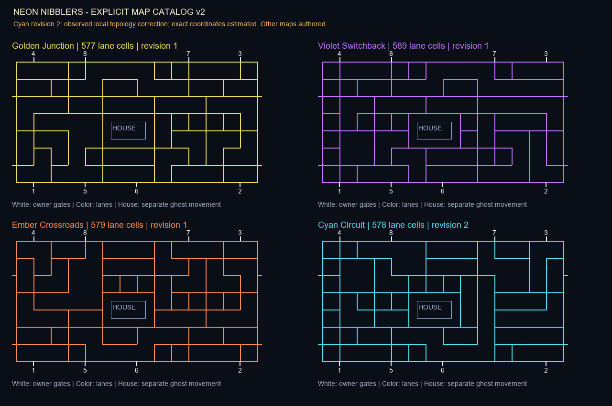

# DX map catalog - revision 14 current status

The production catalog now contains four independently reconstructed observed topology families, each with an original palette and name. This does not establish that the commercial catalog contains only four maps. Exact coordinates, widths, hidden endpoints and transition rules remain approximate or unverified.

| Slot | Profile | Family / revision | Lane cells | Paired tunnel rows | Direct evidence |
|---|---|---|---:|---|---|
| 0 | Golden Rails | D / 4 | 569 | 17 | [5:05](https://www.youtube.com/watch?v=qcO9tzgsdjo&t=305s), complementary5:15 tabletop view |
| 1 | Violet Crosscurrent | B / 3 | 569 | 17 | [1:13](https://www.youtube.com/watch?v=-cNOhumVZ74&t=73s) |
| 2 | Ember Courtyard | C / 4 | 585 | 5,25 | [4:10](https://www.youtube.com/watch?v=qcO9tzgsdjo&t=250s), complementary4:30/4:53/4:59 |
| 3 | Cyan Archway | A / 3 | 582 | 5,25 | [1:08](https://www.youtube.com/watch?v=-cNOhumVZ74&t=68s), corroborated in red at [9:34](https://www.youtube.com/watch?v=43DcDXxEgzk&t=574s) |

All four records use a59x31 movement grid, house `(25,15,9,5)` and bay columns6/20/38/52. C has manually authored offset side-column corridors; D has long center rails and short center capsules. C/D replace the duplicated A/B profiles from revision13. Catalog version5 stores explicit lane rows and source/inference metadata. Runtime does not derive new maps by mirroring.

The renderer keeps26px corridors, preserves narrow connected stems, rounds observed capsule/branch ends and widens only isolated quantized8px bars to16px. This16px choice is a bounded approximation; apparent source widths are roughly18-24px after normalization. Every rendered route retains at least20px radius of opaque-wall clearance. Source screenshots are used only in separate research comparisons, never as game assets.

Nineteen map tests pass, including counts1-8 on all four maps, graph invariants, visible movement edges, body clearance, station transitions and house/capsule contours. See `audits/revision14_maps.md` and the external `outputs/DX-maze-comparison-r14.png` evidence figure.

---

## Historical catalog notes (superseded by revision14 above)

# DX map catalog — revision 12 current status

Two layouts are now independently reconstructed from complete, same-camera DX spectator-screen frames. All four selectable profiles use these two families with original palettes; unsupported authored maze geometries have been retired. **This is not the full commercial catalog, and geometry is quantized rather than pixel-exact.**

| Slot / ID | Current name / revision | Lane cells | Tunnel rows | Evidence |
|---|---|---:|---|---|
| 0 / golden-junction | Golden Archway / 3 | 582 | 5,25 | Observed family A at1:08; original gold palette |
| 1 / violet-switchback | Violet Crosscurrent / 3 | 569 | 17 | Observed topology B at [1:13](https://www.youtube.com/watch?v=-cNOhumVZ74&t=73s); violet palette is original |
| 2 / ember-crossroads | Ember Crosscurrent / 3 | 569 | 17 | Observed family B at1:13; original ember palette |
| 3 / cyan-circuit | Cyan Archway / 3 | 582 | 5,25 | Observed topology A at [1:08](https://www.youtube.com/watch?v=-cNOhumVZ74&t=68s) |

Both observed layouts use den `(25,15,9,5)`, top and bottom bay columns `6,20,38,52`, and a 26px rendered lane radius. Both source layouts appear cyan; color does not identify topology. The source changes from lower-left counter 8 to 9 between these frames. The exact transition trigger, dwell interval, full number/order of maps, map names and color policy remain unverified. These are not inferred from the counter alone.

Independent manual wall-center traces were converted to explicit single-line corridor graphs, then checked against normalized source frames. Original art/code remain procedural. No commercial screenshot is included in the runnable app. Camera perspective, estimated screen corners and movement-grid quantization introduce coordinate uncertainty. Local glare hides the upper endpoint of the wall immediately left of the house and the house doorway; those portions are inferred from adjoining contours and complementary frames. See `audits/revision12_maps.md` for both QA passes and remaining differences.

---

## Historical catalog and investigation (superseded counts retained below)

# DX map research and the authored map catalog

Updated 2026-11-08. Baseline: `0f9c3c98e097d2fb16b058896ba872b31783d2ed` (revision 7).

## Assessment before changes

The previous `Arena` constructor built one wall-path list and reflected it horizontally, vertically, or both. The final variant also altered one path. Snapping and dead-end pruning produced four different connected graphs. This is **IMPLEMENTED AND TESTED**, but not evidence of four DX maps. Color, geometry and progression were coupled to the same integer. Dot clearance immediately incremented the stage and selected the next variant. Neither that trigger nor the cycle is established as a DX rule.

Rendering consumes `arena.space`, the same center-line graph used for collision. Corridor width is produced by a 32-pixel carving radius at a 20-pixel cell pitch; maze nodes are four cells apart. The ghost house and eight owner bays are separate from the public graph. Two horizontal paired tunnels wrap at rows 9 and 25. Those dimensions are authored implementation choices.

## Reference register

| ID | Source/version and time | Observation / evidence status | Limitation and next action |
|---|---|---|---|
| MAP-DX-01 | [Released DX cabinet footage](https://www.youtube.com/watch?v=efLgejKG_ls&t=75s), 1:15, 1:30, 2:00 | **OBSERVED DX**, inherited revision-6 frame review: cyan walls/pockets with yellow gate hatches | Edited camera views do not establish layout order, full graph, or transition cause. Find an unobstructed continuous session spanning two transitions. |
| MAP-CAB-02 | [CHOMPionship cabinet footage](https://www.youtube.com/watch?v=GhSV1oQVA6g&t=57s), 0:57 and 1:35–1:40 | **OBSERVED**, inherited review: single dot paths, border pockets, roaming interior pickups | Exact cabinet configuration/software not established; do not label every detail DX. Obtain a full unobstructed frame and station count. |
| MAP-PROJ-03 | [Mobile/projector presentation](https://www.youtube.com/watch?v=JSp72DKyW5U&t=94s), 1:34 | **OBSERVED**, inherited review: thin rounded wall branches, occupied central house | Supporting visual reference only; not proof of DX layout, timing, display surroundings, or map sequence. |
| MAP-HIST-04 | [Manufacturer original Battle Royale description](https://bandainamco-am.com/collections/pac-man-battle-royale), no video timestamp | **HISTORICAL ONLY**: eating food or all dots refreshes the dot/power pattern | This says reset, not necessarily geometry change, and concerns the earlier four-player game. Do not import as DX rules. |
| MAP-DX-05 | [Current manufacturer DX collection](https://bandainamco-am.com/collections/pac-man-battle-royale-deluxe), read 2026-11-08 | **VERIFIED DX** parts identity; no maze-transition description found | Cannot recover map catalog or triggers from a parts listing. |

The YouTube web reader failed to fetch both cabinet videos in this cycle. The timestamp observations above are explicitly retained from earlier recorded audits, not newly watched sequences. Search surfaced dealer text that repeats the original game's rules and unrelated Mega Tunnel Battle / Championship Edition DX material; these are excluded as DX-transition evidence. No commercial screenshot, code, map file, sprite or recording is distributed.

## Explicit authored database, version 1

`maps.json` now stores each map as explicit 59×31 lane rows, eight entry/spawn pairs, paired portal rows, ghost-house rectangle, palette, identity, revision and provenance. `map_library.py` validates the records and exposes immutable `MapSpec` records. Runtime mirroring is unnecessary; individual geometry can now be corrected and reviewed without changing the other records. Migration preserves every lane, bay, portal and house coordinate from revision 7. **This extraction is an engineering foundation, not a fidelity improvement or a recovered DX catalog.**

| Map ID | Name | Lane cells | Origin | DX topology status |
|---|---|---:|---|---|
| `golden-junction` | Golden Junction | 577 | Authored base | **UNKNOWN** |
| `violet-switchback` | Violet Switchback | 589 | Authored reflected derivative | **UNKNOWN** |
| `ember-crossroads` | Ember Crossroads | 579 | Authored reflected derivative | **UNKNOWN** |
| `cyan-circuit` | Cyan Circuit | 578 | Revision 2: local observed house-perimeter/right-wall correction; remaining authored derivative | Partial **OBSERVED DX**, exact coordinates **INFERRED** |

## Transition policy

The library supplies explicit `cycle`, `repeat`, and seeded `random` selection policies. They are configurable adaptation options, not claims about commercial order. Match integration determines the trigger. Keep the default existing cycle until sufficient evidence supports replacement; do not silently equate an empty dot field with a verified DX stage-change rule.

| Property | Current adaptation | DX evidence status |
|---|---|---|
| Trigger | Empty dot set, if match still active | **UNKNOWN** |
| Order | Four authored variants in cyclic order by default | **UNKNOWN** |
| Geometry/color independence | Data records separately store geometry and palette; current four profiles remain paired | **UNKNOWN** |
| Player-count dependency | Same map for 1–8 participants | **UNKNOWN** |
| Preserved | Logical participants, lives, score, remaining time, bonus-life flag | **UNKNOWN** |
| Reset | Positions, effects, movement clocks, ghost state, dots/items/smoke/quake and spawn clocks | **UNKNOWN** |
| Completion award | Authored survivor bonus, currently 500 | **UNKNOWN** |

## Validation and critical second pass

Pass 1 compared every loaded lane set, entry, spawn, portal and house against the old constructor: all four exactly equal. Pass 2 tested malformed catalogs, duplicate IDs, invalid stations, unpaired portals, house overlap/out-of-bounds, illegal palette, isolated cells and deterministic selection. Added validation for undeclared exits, disconnected lanes, 2×2 dot blocks and unintended dead ends. Four dedicated `test_maps.py` tests pass; game-wide movement/render checks remain necessary after integration.

No full commercial graph has been reconstructed. Highest priority: record a continuous confirmed DX session with readable full playfield, catalog distinct layouts by normalized topology, and inspect each transition frame-by-frame. Repeat across another session and different participant counts before inferring order or triggers. Issue #1 remains open.

## Revision 9 / catalog version 2

Freshly inspected cabinet frames at [1:15](https://www.youtube.com/watch?v=efLgejKG_ls&t=75s) and [2:00](https://www.youtube.com/watch?v=efLgejKG_ls&t=120s), with the doorway orientation normalized by rotating the camera view 180 degrees. Corrected Cyan Circuit locally: the house now has a continuous surrounding corridor; two nearby right-side walls form separate vertical islands. Exact grid dimensions remain estimates, explicitly recorded in map metadata. First three maps retain revision-7 geometry. The earlier migration equality statement applies only to catalog v1; cyan v2 deliberately changes topology.

See [revision-9 map QA](audits/revision9_maps.md) for changes and both validation passes, and [local before/after](images/map_before_after_r9.png). Eight map-specific tests and 29 existing smoke tests passed. This does not close the full-map reconstruction issue.

## Revision 10: review of every current map

All four current maps were compared with the retained actual 1:15/2:00 DX frames for visible house, gate, corridor and wall-style details. This is not a recovered four-map commercial catalog. The detailed [per-map matrix and two-pass review](audits/revision10_all_maps.md) names the corresponding evidence and remaining mismatch for Golden, Violet, Ember and Cyan separately.

Every map already had a complete house-perimeter route (missing-cell counts 0/0/0/0). No unsupported geometry changes were made. Load-time validation now prevents any map from losing that route; ten map tests pass, covering all 1–8 participant counts and stage transitions on every map. Renderer styling adds an inner outline to broad wall interiors, directly motivated by the observed rectangular island; extension to broad bent shapes is explicitly inferred. All 29 existing smoke tests, including route-pixel checks, pass. Map counts and revisions remain unchanged.

New video observation was unavailable in this cycle because the native-browser URL safety check stopped further UI access. Prior captured frames were used and are identified as retained evidence. Full layouts, palette independence and progression remain unresolved.

## Revision 11 — animation, proportions and fresh DX reference review

Fresh real DX footage was viewed safely through normal browser navigation after using a new tab with a verified address. New60/65/124/135second research captures and the report are recorded in audits/revision11_reference.md; camera edits/glare prevent exact cycle timing and a complete commercial map catalog. Distinct house-side geometry appears with the same cyan palette. Palette selection is now independent of layout: F12 cycles wall colors during play, or use `--palette 0..3`. This changes presentation only, not match logic or routes; default progression remains our approximation.

Fixed the left-facing eye/light flip, missing individual ghost stun feedback and tunnel copies, sorted-item animation identity jumps, short respawn/stage cache slides, and animation continuing during pause/guide/results. All11 power icons now use cached3x procedural artwork and position-independent bob phase. Fire is a continuous layered animated plume with a pale core, clipped to reachable corridor endpoints and split correctly at tunnels. Lightning arcs animate. Exact DX art proportions and timing are still unverified.

110 tests cover artwork/time samples, direction, icon sizes16–96px, ghost states, HUD/tunnels, effects, pause/results, respawn, item tracking,720/1080 resizing and palette changes without logic mutation. Two agent QA passes included discovered clipping and freeze regressions followed by corrections. Native1/2/8 render samples cover every map on Windows and Ubuntu/WSLg. These are short graphics checks, not hardware or performance certification; the final plume styling is also checked by the final render suite and recordings. Physical controllers remain deferred to production.

Each1/2/8-player GIF tours four separate6-second map scenarios (24seconds,288frames). New `gameplay_1_player.mp4`, `gameplay_2_player.mp4` and `gameplay_8_player.mp4` show the same tour at1280x720/60fps with original event audio, avoiding GIF color/frame-rate limits. They are actual computer-controlled game simulations. They do not prove a commercial stage sequence or physical-input compatibility.

Optional recording tools: `python -m pip install -r requirements-capture.txt`, then `python record_video.py --players 8 --seconds 6`. They are unnecessary for playing. Native Windows encoding was tested; playback files can be viewed on Windows/Linux with an H.264/AAC player. The game remains Python/Pygame source, not a standalone executable.

See animation_contact_r11.png, animation_review_r11.gif, fire_animation_r11.png and animation_world_effects.png for tested frame sequences and sizes. The matrices document finite reviewed cases; no exhaustive or perfect-commercial-match claim is made. Full DX topology, scoring/timing/AI, death/growth transitions and operator/spectator/attract systems remain unfinished.

## Revision 13 — source measurements, rounded walls and scoring/AI corrections

Fresh confirmed DX footage43DcDXxEgzk was reviewed at quarter speed and paused positions. At9:22 red144640 has four ordinary dots ahead; at9:23 the corridor is cleared and score144680. This OBSERVED DX aggregate supports10 per ordinary dot; it does not recover other score awards or multipliers. At9:23–9:34 the final-life station displays CONTINUE/COIN while AI moves, followed by alphabet/name entry by9:45. No purchased continue, restored-life policy or score retention was observed. The fresh red full-board9:34 is independently identified as existing family A, corroborating color/layout independence, not adding a third maze. Candidate power sequences were rejected as exact duration measurements because of refreshes, occlusion and transition ambiguity. See audits/revision13_reference.md.

Rounded capsule ends and convex branch corners now retain narrow stems and the same validated corridor graph. Removed a faint third house underlay contour; actual-App scans require exactly two house borders on all four profiles. New comparison research images remain outside the runnable package. Exact20px quantization/hidden endpoints, source widths, full commercial catalog and progression remain unverified.

Corrected ledger totals after bot-to-human takeover: historical bot awards remain recorded, while station_join starts the new score account at zero. HUD, spectator rankings and ledger agree. Tested simultaneous dot/power/ghost/rival/bonus awards, duplicate fire attackers, expiry contact, carried ownership and same-tick damage. Bot routing now uses deterministic weighted legal paths, avoiding nearby lethal ghosts/giants/carried rival weapons and actively seeking capturable ghosts with Magnet. This improves our original strategy; exact DX difficulty/targeting remains unknown.

Power durations, movement intervals, ranges, slowdown multipliers and item cadence/cap are now validated per-Match tuning settings, loadable with --tuning tuning.example.json. Complete effective values and pickup duration/nominal expiry are captured in event logs/replays; quickstart and station START honor the same settings. Existing numerical defaults remain explicitly approximate. The on-screen guide reflects effective durations.

Added optional --untimed life-survival mode, also operator time limit0. Default180s remains an explicit custom score-attack mode, not a certified DX limit. Untimed progression, pause, elimination, spectator labels and replay are covered; CLI mode overrides do not silently rewrite saved operator settings. Exact final-life continue interval and background AI before original name entry remain a known presentation/behavior difference; no invented paid-continue policy is claimed.

Results now offer N for original three-letter initials for this session's qualifying top20 human rows. Atomic renaming uses session/player identity, protecting ties and historical/legacy rows. Failed writes roll back; cancelling discards only the active draft. Immediate replay and pending score-save retries remain intact. Exact cabinet entry UI, timeout and physical-controller entry are not reproduced or certified.

Final validation:187 tests passed on Windows and Ubuntu/WSLg, with source-frozen extracted-ZIP verification recorded separately. Native1/2/8 runs cover every profile on both systems, plus actual game/spectator pairs with audio initialization. Twelve complete automated human/AI matches reconcile ledger totals and rankings. Three48-second1280x720/60fps MP4s with original AAC event audio fully decode;24-second GIF previews and12-frame profile/count contact sheet were checked. All recording actors are automated; logical1/2/8 human stations have7/6/0 AI. Physical controllers, human multiplayer acceptance and audible speaker assessment stay in production.

Agent reviews ran initial and deeper passes with targeted fixes/rechecks. Their approval covers tested implementation scope, not undocumented original rules. Remaining exact scoring/power/AI/map/continue questions are tracked honestly; no perfect-match or zero-issues claim.

## Revision 15 — reference audit, uniform graphics and player contact

Fresh continuous DX footage qcO9tzgsdjo around5:00–5:05 shows C morphing into D while walls remain amber. At5:07–5:08 red enlargement accompanies red walls; by5:10/5:13 red and blue giants coexist and walls alternate their colors. The build now retains its base hue through map changes and cycles active giant colors. The1.25-second interval, station order and expiry fallback remain explicit approximations; exact commercial blending/priority is unresolved. Map morphing itself is still not implemented: our stage changes/reset policy remains different.

Native-resolution cardinal outlining made curved wall strokes8.1–8.7% dimmer than horizontal sections. Supersampled circular outlines and a shared premultiplied material reduce the sampled mean difference to0.07–0.34% across four blue maps. Gates, house and tunnel extensions now share luminous stroke construction. Closed gate hatching has the continuous yellow upper lip from the user's photo. All11 pickup icons, eight player colors/directions/sizes, ghost states and world effects were inspected in animation/contact sheets; this does not certify identical commercial assets. Smoke now has soft animated shading and appears immediately on stationary pickup, while the retained trail remains unverified against DX.

The collision report exposed multiple-cell instantaneous shoves and a cooldown that did not prevent repeated impulses. Contact resolution now rolls back the complete group and affected followers, then takes one outward step at normal movement cadence while retaining buffered input. Radius-aware bounded corridor checks reduce visible interpenetration, including tunnels and stationary giant growth. Separate QA caught stationary recoil in the wrong direction and rollback after a later giant hit; both were corrected. This remains a discrete corridor approximation, not recovered continuous DX physics.

HUD scores now show their actual digits, removing the invented six-digit leading-zero padding absent in the user's photo (1760/9460/13530). Existing gate clearance and long-score fitting remain tested. Desktop orientation and the remaining typography/life indicators are still different or unresolved.

Full final source: 271 checks pass on Windows and Ubuntu/WSLg. These include all1–8 rosters/maps and11power categories; no physical-controller certification. A natural continuation replay fixture needed seed0 because the former seed1 survives the60-second window under corrected contact rules; its continuation, score and replay assertions are unchanged. Native1/2/8 runs cover every map; regenerated actual automated gameplay videos include labelled continue scenarios. Source/package tests and decoded media are recorded in current reports.

The full current comparison is DX_CURRENT_GAP_AUDIT.md. All11 categories exist, but numerical power rules, global ghost vulnerability, blanket giant immunity, ghost AI/count/order, attack/combo scoring, spawn distribution, map catalog/progression, paid continuation and several graphical states remain unverified. Agent approval covers stated test scopes only. Controllers remain deferred to production. No exact-match claim.
