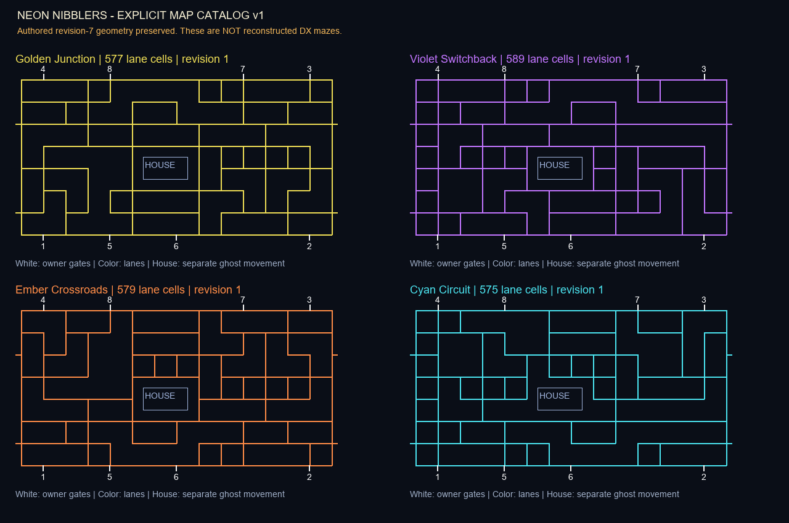

# DX map research and the authored map catalog

Updated 2026-11-08. Baseline: `0f9c3c98e097d2fb16b058896ba872b31783d2ed` (revision 7).

## Assessment before changes

The previous `Arena` constructor built one wall-path list and reflected it horizontally, vertically, or both. The final variant also altered one path. Snapping and dead-end pruning produced four different connected graphs. This is **IMPLEMENTED AND TESTED**, but not evidence of four DX maps. Color, geometry and progression were coupled to the same integer. Dot clearance immediately incremented the stage and selected the next variant. Neither that trigger nor the cycle is established as a DX rule.

Rendering consumes `arena.space`, the same center-line graph used for collision. Corridor width is produced by a 32-pixel carving radius at a 20-pixel cell pitch; maze nodes are four cells apart. The ghost house and eight owner bays are separate from the public graph. Two horizontal paired tunnels wrap at rows 9 and 25. Those dimensions are authored implementation choices.

## Reference register

| ID | Source/version and time | Observation / evidence status | Limitation and next action |
|---|---|---|---|
| MAP-DX-01 | [Released DX cabinet footage](https://www.youtube.com/watch?v=efLgejKG_ls&t=75s), 1:15, 1:30, 2:00 | **OBSERVED DX**, inherited revision-6 frame review: cyan walls/pockets with yellow gate hatches | Edited camera views do not establish layout order, full graph, or transition cause. Find an unobstructed continuous session spanning two transitions. |
| MAP-CAB-02 | [CHOMPionship cabinet footage](https://www.youtube.com/watch?v=GhSV1oQVA6g&t=57s), 0:57 and 1:35–1:40 | **OBSERVED**, inherited review: single dot paths, border pockets, roaming interior pickups | Exact cabinet configuration/software not established; do not label every detail DX. Obtain a full unobstructed frame and station count. |
| MAP-PROJ-03 | [Mobile/projector presentation](https://www.youtube.com/watch?v=JSp72DKyW5U&t=94s), 1:34 | **OBSERVED**, inherited review: thin rounded wall branches, occupied central house | Supporting visual reference only; not proof of DX layout, timing, display surroundings, or map sequence. |
| MAP-HIST-04 | [Manufacturer original Battle Royale description](https://bandainamco-am.com/collections/pac-man-battle-royale), no video timestamp | **HISTORICAL ONLY**: eating food or all dots refreshes the dot/power pattern | This says reset, not necessarily geometry change, and concerns the earlier four-player game. Do not import as DX rules. |
| MAP-DX-05 | [Current manufacturer DX collection](https://bandainamco-am.com/collections/pac-man-battle-royale-deluxe), read 2026-11-08 | **VERIFIED DX** parts identity; no maze-transition description found | Cannot recover map catalog or triggers from a parts listing. |

The YouTube web reader failed to fetch both cabinet videos in this cycle. The timestamp observations above are explicitly retained from earlier recorded audits, not newly watched sequences. Search surfaced dealer text that repeats the original game's rules and unrelated Mega Tunnel Battle / Championship Edition DX material; these are excluded as DX-transition evidence. No commercial screenshot, code, map file, sprite or recording is distributed.

## Explicit authored database, version 1

`maps.json` now stores each map as explicit 59×31 lane rows, eight entry/spawn pairs, paired portal rows, ghost-house rectangle, palette, identity, revision and provenance. `map_library.py` validates the records and exposes immutable `MapSpec` records. Runtime mirroring is unnecessary; individual geometry can now be corrected and reviewed without changing the other records. Migration preserves every lane, bay, portal and house coordinate from revision 7. **This extraction is an engineering foundation, not a fidelity improvement or a recovered DX catalog.**

| Map ID | Name | Lane cells | Origin | DX topology status |
|---|---|---:|---|---|
| `golden-junction` | Golden Junction | 577 | Authored base | **UNKNOWN** |
| `violet-switchback` | Violet Switchback | 589 | Authored reflected derivative | **UNKNOWN** |
| `ember-crossroads` | Ember Crossroads | 579 | Authored reflected derivative | **UNKNOWN** |
| `cyan-circuit` | Cyan Circuit | 575 | Authored reflected derivative plus path variant | **UNKNOWN** |

## Transition policy

The library supplies explicit `cycle`, `repeat`, and seeded `random` selection policies. They are configurable adaptation options, not claims about commercial order. Match integration determines the trigger. Keep the default existing cycle until sufficient evidence supports replacement; do not silently equate an empty dot field with a verified DX stage-change rule.

| Property | Current adaptation | DX evidence status |
|---|---|---|
| Trigger | Empty dot set, if match still active | **UNKNOWN** |
| Order | Four authored variants in cyclic order by default | **UNKNOWN** |
| Geometry/color independence | Data records separately store geometry and palette; current four profiles remain paired | **UNKNOWN** |
| Player-count dependency | Same map for 1–8 participants | **UNKNOWN** |
| Preserved | Logical participants, lives, score, remaining time, bonus-life flag | **UNKNOWN** |
| Reset | Positions, effects, movement clocks, ghost state, dots/items/smoke/quake and spawn clocks | **UNKNOWN** |
| Completion award | Authored survivor bonus, currently 500 | **UNKNOWN** |

## Validation and critical second pass

Pass 1 compared every loaded lane set, entry, spawn, portal and house against the old constructor: all four exactly equal. Pass 2 tested malformed catalogs, duplicate IDs, invalid stations, unpaired portals, house overlap/out-of-bounds, illegal palette, isolated cells and deterministic selection. Added validation for undeclared exits, disconnected lanes, 2×2 dot blocks and unintended dead ends. Four dedicated `test_maps.py` tests pass; game-wide movement/render checks remain necessary after integration.

No full commercial graph has been reconstructed. Highest priority: record a continuous confirmed DX session with readable full playfield, catalog distinct layouts by normalized topology, and inspect each transition frame-by-frame. Repeat across another session and different participant counts before inferring order or triggers. Issue #1 remains open.
