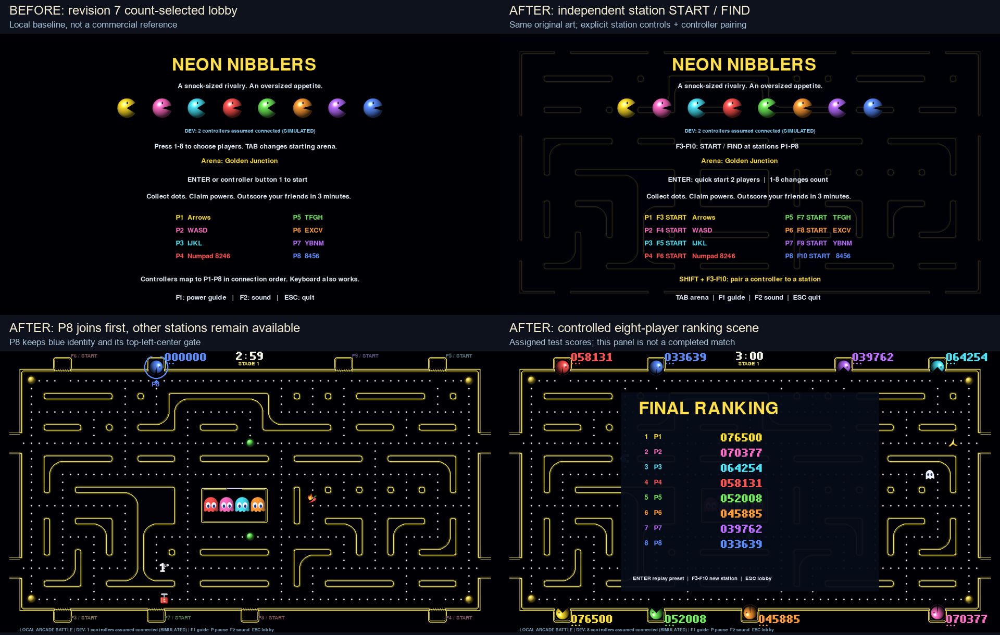
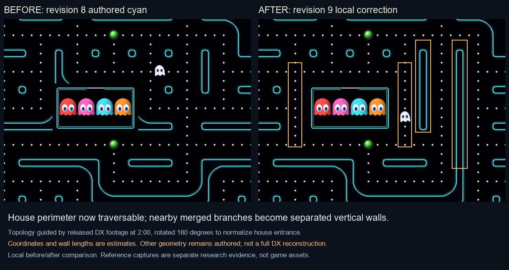
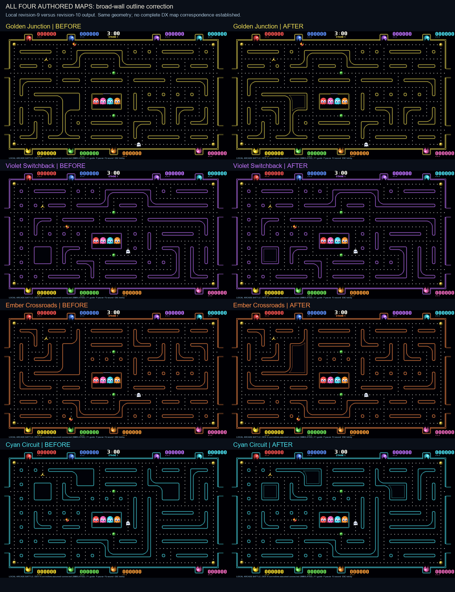

# User-photo comparison - final revision14

`outputs/DX-user-photo-comparison-r14.png` compares the user's clearer familyD photo with the prior wall treatment and actual final blue-palette gameplay. It includes enlarged upper/lower gate details after continuous luminous U outlines, matching hatch direction, wider pockets, pale wall cores and rounded outer-frame corners were verified. Nineteen map tests pass. Desktop scores/prompts remain upright; the photographed cabinet rotates the upper station HUD toward its opposite-side players.

# Revision 14 current comparison

`outputs/DX-maze-comparison-r14.png` compares source, prior local profile and updated local profile for all four observed families. C and D are newly reconstructed from full-board footage in `qcO9tzgsdjo`; A/B retain their established routes with a bounded isolated-stem width correction. `outputs/DX-new-layout-evidence-r14.png` overlays exact movement cells on C/D reference frames. `outputs/DX-stem-detail-r14.png` isolates the local width change. These research images remain outside the playable ZIP.

The complete commercial catalog, precise software-space coordinates, palette policy and transition sequence are not verified. Current shapes are independent original procedural art with documented quantization. See `audits/revision14_maps.md` for both QA passes.

---

## Earlier comparison history

# Revision 13 contour comparison

The latest research figure `outputs/DX-maze-comparison-r13.png` compares the complete68s/73s source boards with identical local geometry before and after rounded capsule/branch-end correction. This fixes a demonstrable square-tip discrepancy while preserving every tested route and thin stem. Fourteen map tests pass. See `audits/revision13_maps.md` for both review passes and explicit remaining uncertainty.

> Current status: see DX_RELEASE_STATUS.md. Earlier revision sections are historical.

# Revision 12 comparison update

Complete spectator-screen references at [1:08](https://www.youtube.com/watch?v=-cNOhumVZ74&t=68s) and [1:13](https://www.youtube.com/watch?v=-cNOhumVZ74&t=73s) now support two independently traced layouts. Source A has the large upper arch and two paired side-tunnel rows; B has the upper central T and one paired central tunnel row. Both have eight bays and a central top-opening house. These replace the previous cyan and violet authored graphs. Golden reuses observed family A and ember reuses family B with original palettes. There are two observed topologies and four palette profiles, not four verified commercial maps.

The new comparison figure is a research artifact outside the runnable ZIP. Red dots over perspective-normalized source frames show the exact independently authored movement graph; adjacent panels show actual app-rendered backgrounds. It is an evidence comparison, not a claim of pixel equivalence. Remaining differences include original character/art styling, approximate line width/rounding, grid-quantized coordinates, palette choices, and the unknown complete commercial catalog.

---

## Earlier comparison history

# DX visual comparison record

Updated 2026-11-08. Keep original branding and independently authored art. A passing software test is not a visual parity verdict.

## Preserved baseline

Revision 7 is commit `0f9c3c9`. Baseline source tests passed 29/29 before changes. Existing 1/2/8-player clips, preview and arena sheet were preserved in `work/revision8-baseline`. These are actual rendered simulations; neither physical controller input nor commercial matching is implied. `map_catalog_v1.png` is a geometry/debug diagram, not gameplay.

## Reference checkpoints and meaningful differences

| Area | Reference / timestamp | Current implementation and difference | Status / next comparison |
|---|---|---|---|
| Wall structure | [Front-facing projector reference](https://www.youtube.com/watch?v=JSp72DKyW5U&t=94s), 1:34 | Thin capsule/L/T outlines improved in revision 5, but broad hooked blocks and small square islands remain authored | **OBSERVED**, non-DX supporting view. Need a full confirmed DX frame before reconstructing topology. |
| Gates | [Released DX cabinet](https://www.youtube.com/watch?v=efLgejKG_ls&t=75s), 1:15 / 1:30 / 2:00 | Yellow hatches are now independent of wall palette. Exact gate dimensions, opening timing and animation remain approximations | Hatch color **OBSERVED DX**; operation **UNKNOWN**. Continuous same-station entry/death/respawn sequence needed. |
| Outer border | [Cabinet reference](https://www.youtube.com/watch?v=GhSV1oQVA6g&t=57s), 0:57 | Twin contours and tunnel necks exist; outer corners still relatively square, unlike softer shapes in earlier review | Observation inherited from prior audit; configuration uncertain. Align a perspective-corrected full board before tuning. |
| Characters | Same cabinet 0:57 and projector 1:34 | Procedural shaded bodies, animated wedge mouths, directional eyes. Giant overhang and original proportions are not measured | **IMPLEMENTED AND TESTED** / exact shape and timing **UNKNOWN**. Compare a multi-frame normal/giant sequence, not one still. |
| Ghost house | Projector 1:34 | Four visible occupants and continuous return implemented; initial coordinates/release order are authored | **UNKNOWN DX**. Confirm house-only clip through all four exits. |
| Scores/stations | [DX manufacturer manual](https://www.bmigaming.com/Games/Manuals/namco/Pac-Man-Battle-Royale-Chompionship-Deluxe-Video-Arcade-Game-Manual-Bandai-Namco.pdf), control-panel diagram | Station/color order follows documentation; on-screen score size, placement, animation and leaderboard are not measured | Station diagram **VERIFIED DX**; display dimensions **UNKNOWN**. Capture startup/play/results at comparable counts. |
| Startup | [Manufacturer DX parts](https://bandainamco-am.com/collections/pac-man-battle-royale-deluxe), eight Find My Pac/Start decals | Baseline is a count-selected text lobby; independent station actions were missing | Action existence **VERIFIED DX**; exact join/locator animation **UNKNOWN**. Current engineering cycle addresses independent station control. |

No new reference video frame was captured in this map audit: the web reader could not retrieve the footage. Prior audits contain the actual observation history. Do not label this document an aligned side-by-side original/game comparison, or manufacture a reference image from a description. Reference capture, corner selection, perspective correction and frame-sequence comparison remain an explicit gap.

## This cycle: geometry provenance, not cosmetic certification

The map data migration preserves all four graphs exactly. There is therefore intentionally no claimed visual improvement from that migration alone. The new [catalog diagram](images/map_catalog_v1.png) exposes station order, topology and house placement for future corrections. The remaining visible discrepancies above stay open.

For each future reconstructed map, store a reference record with URL, cabinet/version confidence, exact timestamp, unobstructed corner coordinates and observation notes. Keep independently generated output captures separate. Compare equivalent player counts/states, normalize the playfield rectangle, annotate topology differences first, then wall width, sprites and HUD. Test collision edges against the revised rendered walls, regenerate moving clips and repeat critical review.

## Review outcome

First pass: verified the migration is data-only and preserves reachable routes. Second pass: checked the claim boundary; existing screenshots do not prove any DX transition rule, and four differently colored reflected maps do not establish a commercial map catalog. Full-frame reference reconstruction and aligned 4/8-player/startup comparison remain high-priority work, not completed items.

## Integrated station/UI comparison

This comparison uses our own revision-7 lobby as the baseline. The new per-station controls, pairing prompt, first-player P8 and ranking list are visible. The ranking panel uses assigned test scores; it is explicitly labeled a controlled scene, not a completed match. This is deliberately not labeled a commercial-game comparison. The companion `gameplay_4_player.gif` records eight seconds of actual four-player simulation (96 frames, seed 24); frames at 0, 3.3 and 6.7 seconds were visually inspected. See `audits/revision8_maps.md` for tested cases and the reproduced, corrected and rechecked locator clipping.

## Revision 9 cyan topology correction

Unlike the revision-8 data migration, this changes playable routes. Actual cabinet frames at [2:00](https://www.youtube.com/watch?v=efLgejKG_ls&t=120s) and [1:15](https://www.youtube.com/watch?v=efLgejKG_ls&t=75s) show the house separated from nearby branches by a corridor and distinct vertical wall islands. The view is rotated 180 degrees relative to our house entrance; the two raw-left vertical islands therefore belong on the game's right. Our revised cyan map opens the house perimeter and separates these walls. The figure above compares our old/new output; it does not pretend the estimated grid is a perspective-perfect original trace. See `audits/revision9_maps.md` for the tested change and remaining uncertainty.

## Revision 10: all four maps, broad-wall styling

Each row uses identical local geometry and frame state, comparing revision-9 rendering with revision-10 rendering. All four were separately reviewed against retained DX frame details. Violet's broad rectangle provides the clearest observed-style correction: its inner outline is now distinct from its outer outline, as on the rectangular island visible at 1:15. Applying this treatment to broad bent walls is an inferred style choice, not a measured commercial match. Thin capsules, ghost-house contours and gates are unchanged. See [the per-map evidence/difference matrix and pixel checks](audits/revision10_all_maps.md). No fresh video or exact four-map DX correspondence is claimed.

## Fresh released-DX enclosure comparison

The subsequent native-browser review did obtain new reference imagery, superseding the map-audit access limitation above. Actual efLgejKG_ls frames at75/90/120s were inspected, plus the15s instruction presentation. The research figure `outputs/DX-house-comparison-r8.png` is delivered separately from the playable ZIP. It contains a120s enclosure crop, rotated180 degrees for doorway orientation, beside baseline/current game crops. Perspective and glare remain; images are resized for inspection without invented geometric reconstruction.

The figure caught an initial regression: baseline already had two visible contours contributed by background and foreground layers; simply adding an inset produced three. Final rendering clears the background house edge and explicitly draws two consistently separated contours. All-four-theme checks count exactly two bright runs, reject the old third line and verify the inner doorway stays open. This is controlled render correction, not proof of exact commercial line dimensions, topology, actor states or animation.

## Fresh released-DX house comparison and corrective review

The reference reviewer subsequently accessed the actual video in native Chrome, inspecting15/75/90/120seconds. A research screenshot at2:00 supports the observed two house contours; the separate `outputs/DX-house-comparison-r8.png` figure compares this crop with our baseline/current rendering. It retains camera perspective/glare and is not part of the playable ZIP or commercial game assets. It does not establish exact proportions or complete map topology.

The first proposed inset outline was wrong: our background already supplied an outer edge, so the change produced three lines. Actual crop review exposed this despite a passing draw-location test. The correction clears the background house edge, then draws exactly two explicit contours and an open inner doorway. The final regression counts visible bright runs, rather than treating two drawing calls as proof. This cycle demonstrates why rendered comparison and critical retesting matter.

## Revision 11 — animation, proportions and fresh DX reference review

Fresh real DX footage was viewed safely through normal browser navigation after using a new tab with a verified address. New60/65/124/135second research captures and the report are recorded in audits/revision11_reference.md; camera edits/glare prevent exact cycle timing and a complete commercial map catalog. Distinct house-side geometry appears with the same cyan palette. Palette selection is now independent of layout: F12 cycles wall colors during play, or use `--palette 0..3`. This changes presentation only, not match logic or routes; default progression remains our approximation.

Fixed the left-facing eye/light flip, missing individual ghost stun feedback and tunnel copies, sorted-item animation identity jumps, short respawn/stage cache slides, and animation continuing during pause/guide/results. All11 power icons now use cached3x procedural artwork and position-independent bob phase. Fire is a continuous layered animated plume with a pale core, clipped to reachable corridor endpoints and split correctly at tunnels. Lightning arcs animate. Exact DX art proportions and timing are still unverified.

110 tests cover artwork/time samples, direction, icon sizes16–96px, ghost states, HUD/tunnels, effects, pause/results, respawn, item tracking,720/1080 resizing and palette changes without logic mutation. Two agent QA passes included discovered clipping and freeze regressions followed by corrections. Native1/2/8 render samples cover every map on Windows and Ubuntu/WSLg. These are short graphics checks, not hardware or performance certification; the final plume styling is also checked by the final render suite and recordings. Physical controllers remain deferred to production.

Each1/2/8-player GIF tours four separate6-second map scenarios (24seconds,288frames). New `gameplay_1_player.mp4`, `gameplay_2_player.mp4` and `gameplay_8_player.mp4` show the same tour at1280x720/60fps with original event audio, avoiding GIF color/frame-rate limits. They are actual computer-controlled game simulations. They do not prove a commercial stage sequence or physical-input compatibility.

Optional recording tools: `python -m pip install -r requirements-capture.txt`, then `python record_video.py --players 8 --seconds 6`. They are unnecessary for playing. Native Windows encoding was tested; playback files can be viewed on Windows/Linux with an H.264/AAC player. The game remains Python/Pygame source, not a standalone executable.

See animation_contact_r11.png, animation_review_r11.gif, fire_animation_r11.png and animation_world_effects.png for tested frame sequences and sizes. The matrices document finite reviewed cases; no exhaustive or perfect-commercial-match claim is made. Full DX topology, scoring/timing/AI, death/growth transitions and operator/spectator/attract systems remain unfinished.

## Revision 12 — reconstructed layouts and cabinet lifecycle

Current production routes are independently reconstructed from two full DX spectator views at68/73seconds in the IAAPA2022 source. All four color profiles use these two families; unsupported authored routes are retired. Quantization and glare-hidden endpoints remain approximate; no complete commercial catalog or pixel identity is certified. Ghost house paths, tunnels and bays now derive from each profile's geometry. Actual-width render checks caught and fixed erased wall stems, and new bay positions required a dynamic central HUD clearance fix.

AI actors were observed alongside join prompts. Vacant stations now have configurable AI opponents; human counts, controls, credits and rankings remain distinct. Human takeover resets bot scores, carried weapons and growth; eliminated humans cannot revive through Start. All-human elimination ends a match even if bots survive. Exact DX difficulty/replacement rules remain unknown.

Implemented smooth growth/shrink, death dissolve, bay arrival feedback, saved operator settings, credits/free play, persistent local human scores with failure retry, original idle instructional/high-score attract pages and optional spectator mirrors/ranking windows. Their detailed UI/timing are original adaptations. Native game+spectator pairs ran on Windows and Ubuntu/WSLg.

151 tests pass locally on both OS environments. Twelve complete automated human/AI matches ended with reconciled event totals and human-only rankings; native1/2/8 checks cover all four profiles on both systems. Physical controllers remain deferred to production. Current recordings use1/2/8 logical human slots with7/6/0 AI opponents; all actors are computer-controlled during capture.

Current acceptance/evidence boundaries are in DX_RELEASE_STATUS.md. Software features are implemented and tested; exact commercial score/multiplier values, timings, AI, joining/progression rules, full map inventory and overhead content by state remain unverified. Open evidence issues are not administratively closed to claim completion.

## Revision 13 — source measurements, rounded walls and scoring/AI corrections

Fresh confirmed DX footage43DcDXxEgzk was reviewed at quarter speed and paused positions. At9:22 red144640 has four ordinary dots ahead; at9:23 the corridor is cleared and score144680. This OBSERVED DX aggregate supports10 per ordinary dot; it does not recover other score awards or multipliers. At9:23–9:34 the final-life station displays CONTINUE/COIN while AI moves, followed by alphabet/name entry by9:45. No purchased continue, restored-life policy or score retention was observed. The fresh red full-board9:34 is independently identified as existing family A, corroborating color/layout independence, not adding a third maze. Candidate power sequences were rejected as exact duration measurements because of refreshes, occlusion and transition ambiguity. See audits/revision13_reference.md.

Rounded capsule ends and convex branch corners now retain narrow stems and the same validated corridor graph. Removed a faint third house underlay contour; actual-App scans require exactly two house borders on all four profiles. New comparison research images remain outside the runnable package. Exact20px quantization/hidden endpoints, source widths, full commercial catalog and progression remain unverified.

Corrected ledger totals after bot-to-human takeover: historical bot awards remain recorded, while station_join starts the new score account at zero. HUD, spectator rankings and ledger agree. Tested simultaneous dot/power/ghost/rival/bonus awards, duplicate fire attackers, expiry contact, carried ownership and same-tick damage. Bot routing now uses deterministic weighted legal paths, avoiding nearby lethal ghosts/giants/carried rival weapons and actively seeking capturable ghosts with Magnet. This improves our original strategy; exact DX difficulty/targeting remains unknown.

Power durations, movement intervals, ranges, slowdown multipliers and item cadence/cap are now validated per-Match tuning settings, loadable with --tuning tuning.example.json. Complete effective values and pickup duration/nominal expiry are captured in event logs/replays; quickstart and station START honor the same settings. Existing numerical defaults remain explicitly approximate. The on-screen guide reflects effective durations.

Added optional --untimed life-survival mode, also operator time limit0. Default180s remains an explicit custom score-attack mode, not a certified DX limit. Untimed progression, pause, elimination, spectator labels and replay are covered; CLI mode overrides do not silently rewrite saved operator settings. Exact final-life continue interval and background AI before original name entry remain a known presentation/behavior difference; no invented paid-continue policy is claimed.

Results now offer N for original three-letter initials for this session's qualifying top20 human rows. Atomic renaming uses session/player identity, protecting ties and historical/legacy rows. Failed writes roll back; cancelling discards only the active draft. Immediate replay and pending score-save retries remain intact. Exact cabinet entry UI, timeout and physical-controller entry are not reproduced or certified.

Final validation:187 tests passed on Windows and Ubuntu/WSLg, with source-frozen extracted-ZIP verification recorded separately. Native1/2/8 runs cover every profile on both systems, plus actual game/spectator pairs with audio initialization. Twelve complete automated human/AI matches reconcile ledger totals and rankings. Three48-second1280x720/60fps MP4s with original AAC event audio fully decode;24-second GIF previews and12-frame profile/count contact sheet were checked. All recording actors are automated; logical1/2/8 human stations have7/6/0 AI. Physical controllers, human multiplayer acceptance and audible speaker assessment stay in production.

Agent reviews ran initial and deeper passes with targeted fixes/rechecks. Their approval covers tested implementation scope, not undocumented original rules. Remaining exact scoring/power/AI/map/continue questions are tracked honestly; no perfect-match or zero-issues claim.

## Revision 14 — four observed layouts, recovered pellet awards and station continues

Fresh confirmed eight-station DX footage qcO9tzgsdjo at0:01/0:03 displays HOW TO PLAY awards: ordinary dot10, yellow pellet100, green pellet1000. These are OBSERVED DX for the pictured build, independently read by root and mechanics reviewer. Gold/Giant no longer receive the generic75 pickup award; other items, ghost/rival awards and combos remain explicitly unrecovered estimates. Pickup events retain their event identity and now identify the score rule. Repeat-pickup and same-tick tests use the newly observed values.

The same source at4:10/4:53 and5:05/5:15 shows two more distinct mazes. The runtime catalog now has four independently reconstructed observed families:0 Golden Rails/D569cells,1 Violet Crosscurrent/B569,2 Ember Courtyard/C585,3 Cyan Archway/A582. C was traced by the map reviewer and independently checked by the research reviewer; D was independently traced by research and critically reviewed by maps. Isolated narrow wall bars were widened from8 to16px, while every route retains20px normal-body clearance. Seventeen map checks cover all1-8 counts, edges, tunnels, gates, house contours, landmarks and no unintended open2x2/dead ends. Coordinates and hidden endpoints remain approximations; four observed families do not prove the complete commercial catalog or stage order.

Source43DcDXxEgzk brackets CONTINUE near9:25–9:35; qcO9tzgsdjo shows CONTINUE6 at5:11 and2 at5:15. A source-informed10-second station offer now follows a custom1-second reveal delay after final human death. AI/ghost simulation continues; all-human elimination is deferred until offers expire. Living humans keep playing while another station has an offer. Start redeems a valid offer after atomic software-credit/free-play authorization; failure/pending/paused/repeated inputs never debit incorrectly. The independent restoration policy preserves score and earned-bonus flag and restores configured starting lives. Actual paid source continuation and its score/life policy remain unobserved. Timed expiration overrides offers. Last-offer timeout settles scores once and automatically opens qualifying initials; other results retain optionalN entry.

Continuation state is deterministic, snapshot/replay-visible and pause/guide-safe. Raw Match defaults disable offers for explicit legacy/timed scenarios; normal App defaults enable10seconds. --continue-seconds0 disables; --continue-delay adjusts the explicitly custom reveal. INSERT supplies development credits during an offer; C remains lobby credit/P6-down during active play. Continue text was moved to clear the lower footer. Tests found and fixed that input conflict and footer overlap, and verify pending score-write retry, no duplicate charge, simultaneous/staggered stations and automatic name-entry recovery.

Ghost navigation now uses legal corridor distance rather than Manhattan shortcuts through walls or across the long side of a tunnel. It avoids immediate reversal when another exit exists. Five navigation checks cover a formerly oscillating U-shaped wall trap, all-map shortest tunnel routes, frightened retreat, normal wandering and dead-end return. Bot risk weights, ghost target choices and difficulty remain original, not recovered cabinet AI.

Actual extra-life and score-threshold events now trigger the original bonus cue; capped/eliminated zero-gain events do not falsely celebrate a life. Continue uses the original join cue. A spectator export check uncovered an image-save exception; pygame image I/O errors now leave play running with a visible message. Native test feed paths were also separated by platform to avoid two test writers sharing one file. The corrected game/viewer pairs passed on both systems.

Final source-frozen verification:238 tests passed on Windows and Ubuntu/WSLg; extracted-ZIP verification is recorded separately. Twelve complete automated matches reconcile score accounts and human rankings. Native1/2/8 checks cover every map on both systems; native final-life/countdown/accept/expiry/automatic-initials sequences pass Windows and Ubuntu. Three80-second1280x720/60fps AAC recordings fully decode:48seconds of four-map gameplay plus two16-second clearly labelled controlled continue scenarios. All actors are automated;1/2/8 logical human stations have7/6/0 AI opponents. Twenty-one decoded frames cover all maps and continue states. GIF previews show24seconds of map gameplay. No physical controllers, eight-human acceptance, audible speaker assessment or standalone Linux hardware are certified.

Two-pass map/reference/mechanics reviews and targeted fix/retests are documented in revision14 audits. Exact power durations/stacking, remaining award/combo values, complete map inventory/order, paid source continuation and original AI remain unresolved. Candidate stage-during-continue evidence was specifically falsified: the new maze already existed before the source offer. No fabricated certainty or perfect-match claim is made.

## Clearer user photo — gates and wall rendering

The supplied higher-quality photo independently matches family D / Golden Rails at all visible major junctions; no new topology was needed. Added a fifth selectable luminous blue palette (`--palette 4`) independent of all four maps. New `photo_map_windows.bat` and `photo_map_linux.sh` launch that map/color in development simulation and untimed mode.

The image exposed undersized, weakly lit pockets and sparse line hatches. New independently drawn64x48 continuous double-U bays have48x10 filled lemon-yellow strips with dark diagonal slashes, pale cores and real alpha-aware glow. Upper/lower stripe directions match. The outer field corners are rounded, walls have soft halos and pale inner ink, and the house has clearly separated double contours with an open inner doorway. Source dimensions and camera bloom remain estimates; no commercial bitmap enters the game.

Normal actors now sit at the actual outside-pocket center; their dedicated bounded render pass lets them enter/leave through the mouth while protecting score/life text. AI occupancy opens its physical gate even though its human HUD remains unjoined. The enlarged bays fit a720p canvas after a5px field shift; lower HUD stays fixed and the controller/simulation footer occupies a reserved central gap. Full save-error messages use a bounded toast. Desktop score orientation remains upright, while the photo's opposite-side cabinet prompts are rotated.

Critical QA found and fixed invisible transparent-surface halos, stale spawn-center rendering, AI hatches staying shut, and a widened house inner line crossing its door. Eleven new gate checks and19 map checks cover actual pixels, soft glow, parallel borders, body fit, departure/return, all8stations/all4profiles, empty/dead/continue states, five palettes, score/life/footer clearance and the full house opening. Combined targeted24 checks passed, followed by full238-check Windows/Ubuntu runs. The final recordings and native checks were regenerated after these fixes, with Golden Rails in blue.

The static photo improves visual evidence; it does not measure original gate release timing, paid-continuation restoration or physical-controller behavior. Controllers remain deferred to production.

## Revision 15 — reference audit, uniform graphics and player contact

Fresh continuous DX footage qcO9tzgsdjo around5:00–5:05 shows C morphing into D while walls remain amber. At5:07–5:08 red enlargement accompanies red walls; by5:10/5:13 red and blue giants coexist and walls alternate their colors. The build now retains its base hue through map changes and cycles active giant colors. The1.25-second interval, station order and expiry fallback remain explicit approximations; exact commercial blending/priority is unresolved. Map morphing itself is still not implemented: our stage changes/reset policy remains different.

Native-resolution cardinal outlining made curved wall strokes8.1–8.7% dimmer than horizontal sections. Supersampled circular outlines and a shared premultiplied material reduce the sampled mean difference to0.07–0.34% across four blue maps. Gates, house and tunnel extensions now share luminous stroke construction. Closed gate hatching has the continuous yellow upper lip from the user's photo. All11 pickup icons, eight player colors/directions/sizes, ghost states and world effects were inspected in animation/contact sheets; this does not certify identical commercial assets. Smoke now has soft animated shading and appears immediately on stationary pickup, while the retained trail remains unverified against DX.

The collision report exposed multiple-cell instantaneous shoves and a cooldown that did not prevent repeated impulses. Contact resolution now rolls back the complete group and affected followers, then takes one outward step at normal movement cadence while retaining buffered input. Radius-aware bounded corridor checks reduce visible interpenetration, including tunnels and stationary giant growth. Separate QA caught stationary recoil in the wrong direction and rollback after a later giant hit; both were corrected. This remains a discrete corridor approximation, not recovered continuous DX physics.

HUD scores now show their actual digits, removing the invented six-digit leading-zero padding absent in the user's photo (1760/9460/13530). Existing gate clearance and long-score fitting remain tested. Desktop orientation and the remaining typography/life indicators are still different or unresolved.

Full final source: 271 checks pass on Windows and Ubuntu/WSLg. These include all1–8 rosters/maps and11power categories; no physical-controller certification. A natural continuation replay fixture needed seed0 because the former seed1 survives the60-second window under corrected contact rules; its continuation, score and replay assertions are unchanged. Native1/2/8 runs cover every map; regenerated actual automated gameplay videos include labelled continue scenarios. Source/package tests and decoded media are recorded in current reports.

The full current comparison is DX_CURRENT_GAP_AUDIT.md. All11 categories exist, but numerical power rules, global ghost vulnerability, blanket giant immunity, ghost AI/count/order, attack/combo scoring, spawn distribution, map catalog/progression, paid continuation and several graphical states remain unverified. Agent approval covers stated test scopes only. Controllers remain deferred to production. No exact-match claim.

## Revision 16 — exterior spacing and continuous maze changes

The user's annotated image exposed a real mismatch: exterior wall cores were3px apart while bay cores were6px apart. The exterior now has the same6px separation, concentric corner curves, aligned gate shoulders and continuous tunnel joins. A second review found and fixed lower gates being dimmer due to inconsistent supersampling phase. All four maps/five palettes/eight station joins were checked, with unchanged public lanes and body clearance.

Two fresh passes through Harold Zheng's DX footage (qcO9tzgsdjo,5:02–5:04) show actors staying on the field, maze compression/change, temporary enlargement of both players and ghosts, and scattered dot refill. The game now preserves actors across stage changes instead of resetting everybody to bays/house. Legal actor and item positions are reserved before displaced objects get the nearest free lane. Ghost release/return/carrier state, scores, lives, ongoing effects and continue timers persist. Exact relocation and power persistence remain our stated policy, not recovered source rules. The initial/new-match reset is unchanged.

An original1.1-second shrink/blend/expand animation replaces the instant layout swap. Actor enlargement is visual only; it never changes combat size or grants a power. Dots refill visibly and become collectible together between0.6 and1.1 seconds, with no accidental second stage-clear during refill. HUD scores stay stationary and pause/help/results freeze the animation. The0.90 maze scale,1.35 actor pulse, short midpoint overlap, timing and trajectories remain approximations; source footage does not establish an exact curve or whether movement pauses.

The deeper transition review caught a moving item stealing an already-valid static pellet position; the reservation fix is covered by a regression. Legacy tests that required a global respawn were updated to require continuous legal placement. The independent transition tests cover all16 ordered map changes, eight-player conflicts, private bays, inactive stations, continuation, carried/returning/releasing ghosts, refill and render immutability.

All288 checks pass on Windows and Ubuntu/WSLg. Native checks cover1/2/8 on all four maps (24 cases), plus actual transition runs for those counts on both systems (six cases). Twelve complete simulated matches reconcile scoring/rankings, and a720-frame472-event replay verifies deterministically. Audio initialized; physical input and audibility are not certified. Initial geometry construction still causes a first-use render delay; short native startup-inclusive figures are not steady-state performance claims.

Three new88-second1280x720/60fps recordings contain48seconds of all-map gameplay, an8-second labelled controlled C-to-D transition, and32seconds of labelled continue acceptance/expiry. All actors are automated;1/2/8 human-designated stations have7/6/0AI. Fresh24-second GIF map tours, all11-power/player/ghost animation sheets and actual transition frame sequences accompany review.

The source clearly shows a3000 popup associated with this transition; its universal award/recipient/scaling rules remain unknown, so the configurable500 simulation clear award is not promoted as authentic. All11 power categories are present and tested internally, but exact durations/spawn rates/stacking, global ghost vulnerability, ghost targeting/release and several source artwork details remain unresolved. Original sprites/audio/branding are retained. Controllers remain deferred to production; no perfect-match or zero-issue claim.

## Revision 17 — responsive input, continuous motion and reference-informed pace

Two normal-looking actors in real DX footage qcO9tzgsdjo4:09/4:11/4:13 cover approximately12–15 dot spacings in nominal4seconds. Whole-second timestamps and camera perspective leave a conservative2.4–5dots/second range; hidden power status is not fully excluded. Our previous10dots/second was likely materially faster. The new provisional default is4dots/second (.25s per20px cell). Rush/Slick/ghost/item intervals are.1625/.1375/.40/.60s, preserving earlier authored relative speeds; those ratios are not recovered DX facts. The old fast profile remains selectable with --tuning tuning.fast.json. Power durations, probabilities, spawn interval and collision impulse constants were not guessed from this footage.

Fixed a concrete keyboard bug: held Up overwrote a freshly pressed Right in the next input poll. Every station now uses its most recently pressed held direction; releases fall back to remaining held keys, and no-key state retains buffered intent. Legal facing/reversals update without granting distance or resetting movement clocks. Invalid turns stay buffered until a junction. Slick/recoil remain in control during their effects. Discrete travel decisions still occur on the movement cadence; immediate facing does not eliminate the possible250ms positional wait or constitute a continuous subcell physics model.

Replaced exponential visual easing with constant-speed axis-aligned waypoint motion for players, ghosts and moving items. This avoids bursts/holds at the slower cadence and prevents rounded diagonal cuts through corners. Logical reversals cancel abandoned forward waypoints, tunnel coordinates wrap, damage/restart reset tracks, and50px gate movement receives its own distance scaling. Pause/help/results freeze motion; rendering changes no Match state. Very long frames crossing multiple unseen turns can snap to the final cell rather than inventing a route. Normal30/60/144Hz default-speed tests do not encounter that case.

Bot navigation now recognizes nearby powers across tunnel connections, prioritizes vulnerable rivals while giant even when ghosts are in their house, and chooses a legal safer fallback when goals disappear during refill. Six adversarial/navigation tests and independent review cover these fixes. No new collision-resolver defect was reproduced; all-map crowds recover, retain controls and avoid overlaps/extra-cell jumps. With slower speed, densely packed eight-player crowd recovery takes longer in wall-clock time; this tradeoff remains documented.

Paired90-second eight-actor simulations isolate pace from the bot changes: death events140→54, rival hits93→30, pickups298→285 and mean stage4.75→2.25. Near-rival proximity rises.190→.227, but it is a Manhattan-distance proxy, not a collision measurement. Separate1/2-actor experiments do not include the application's vacant-station bots. These metrics show less rapid churn and fewer attacks, not greater enjoyment. All90s observations are censored for finish time; no survival-length conclusion. No human multiplayer fun-equivalence test has been completed.

Maze geometry is now prepared before play. One local dummy-render comparison moved first-layout-change rendering from.9999s to.0084s, with3.5794s spent preparing four mazes before play; this is a measured cold-start comparison, not a guaranteed native FPS claim. The game shows Preparing mazes during that work. Actual four-map slow tour review found zero off-centerline positions across17,117 player samples, and straight/tunnel motion at60Hz consistently1.333333px per moving frame.

All328 checks pass Windows and Ubuntu/WSLg. Native runs cover all four maps with1/2/8 human-designated stations plus six transition runs, using7/6/0AI fill; audio initializes, physical input/audibility remains uncertified. Twelve full automated matches reconcile scores and rankings; deterministic replay, stress checks and extracted-package validation are recorded separately. Updated104-second720p60AAC videos show64seconds of four-map play,8seconds of labelled controlled C-to-D transition and32seconds of labelled continue scenarios. All capture actors are automated.

Agents completed initial and deeper passes, with targeted fixes/rechecks. The task-owned research YouTube tab/window was closed and its removal verified; other user applications were left untouched. Physical controllers remain deferred to production. Exact DX power timing, ghost rules, collision physics, scoring, artwork and subjective fun are not certified. Original assets/code/audio remain independently authored.
