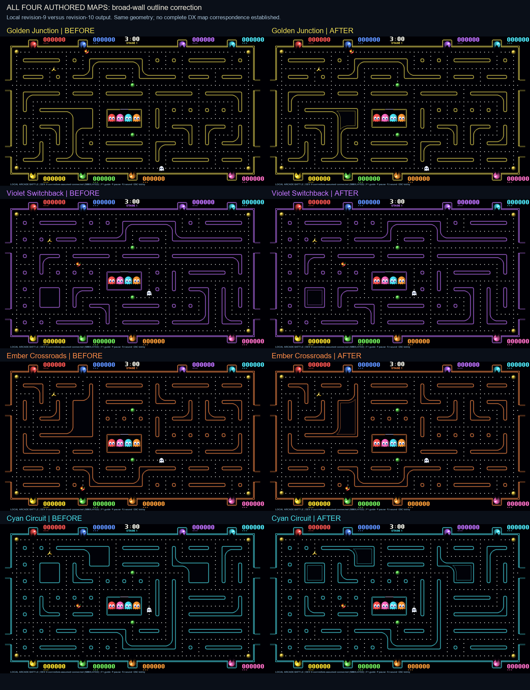

# Revision 10: every authored map reviewed

2026-11-08. Baseline source: `2165f5a`. Review covers all four current maps, not just Cyan Circuit. Physical controller validation remains deferred to production.

## Evidence boundary

Used the retained actual DX camera captures at [1:15](https://www.youtube.com/watch?v=efLgejKG_ls&t=75s) and [2:00](https://www.youtube.com/watch?v=efLgejKG_ls&t=120s), reviewed during revision 9. The doorway points down in these camera images, so orientation must be rotated 180 degrees relative to our top-door simulation. The attempted new native-browser research was stopped by a URL safety check; **no fresh video observation is claimed in revision 10**. These cropped, angled views cannot identify four complete commercial layouts or establish color-to-layout correspondence.

The clearest applicable styling detail is the double bright outline of a broad rectangular wall island in the 1:15 view. Slim capsule walls remain single outlined shapes. The 2:00 view supports the prior local Cyan house-route/right-wall correction. Neither permits inventing exact coordinates for the other three mazes.

## Per-map comparison matrix

| Our map / current revision | Reference comparison performed | Actual geometry / discrepancies | Change and evidence status | Still unresolved |
|---|---|---|---|---|
| Golden Junction / 1 | Compared fresh local full frame with retained 1:15/2:00 DX captures for house separation, wall style, gates and dot paths | 577 lane cells; complete house loop already present. Large authored left-middle bent wall and upper arch have no demonstrated exact commercial counterpart. Small round/square islands and branch positions remain authored. | Added an inset contour only inside sufficiently broad wall regions. Rectangular-island style is **OBSERVED DX**; applying it to Golden's broad bent shape is **INFERRED**, not exact topology evidence. No route change. | Entire normalized DX counterpart, exact broad-wall shape and dimensions, tunnel placement, color identity and progression. |
| Violet Switchback / 1 | Same retained DX references; strongest comparison is our broad lower-left rectangular island versus the observed double-contour rectangular object type | 589 lane cells; complete house loop already present. Broad rectangle was single outlined; surrounding authored branches have not been matched to a full DX frame. | Rectangle now has separate inner and outer contours, guided by **OBSERVED DX** object styling. Placement, size and purple theme association remain **UNKNOWN**. No route change. | A complete corresponding map, palette/layout independence, full rectangle dimensions and neighboring corridor topology. |
| Ember Crossroads / 1 | Same retained frames, focusing on large bent wall, house corridor and narrow capsules | 579 lane cells; complete house loop already present. Large upper-left bent wall is an authored reflected derivative, not a verified DX wall. | Inset added only to broad interiors; common styling extrapolation is **INFERRED**. Thin capsule contours preserved. No route change. | Exact maze identity, bent-wall shape, flame/orange palette in commercial layout, topology and transitions. |
| Cyan Circuit / 2 | Retained 2:00 frame for separated right-side wall islands and house loop; 1:15 for broad rectangular-island styling | 578 lane cells. Revision-9 qualitative local correction retained; remaining branches and dimensions still authored/estimated. Full maze not visible in either capture. | Broad rectangle gains observed-style inner contour; broad bent components use the same **INFERRED** treatment. Prior local topology remains partial **OBSERVED DX**, estimated coordinates. No new route change. | Full normalized layout, precise two-capsule lengths, remaining branches, dot distribution and commercial order. |

No “four maps matched” claim follows from this review. Each was compared for details visible in the available evidence; no one-to-one four-map commercial catalog was recovered.

## Pass 1: map facilities and implementation

Computed the complete house-perimeter set for every map. Missing cells: **0/0/0/0**. Reapplying the previous Cyan correction to other maps would therefore invent changes. All route geometry and map revisions stay unchanged in this cycle.

Added a load-time invariant in `map_library.py`: every authored map must preserve its declared house's surrounding single-line route under our two-cell spacing convention. This prevents future edits from reintroducing the merged-house defect. The spacing convention is ours, not a recovered DX dimension. Added tests walking each complete loop and testing rejection when each map's door approach is removed. Ten map tests pass, including moving counts 1–8 on every map, sparse first joins, transitions and station-label bounds.

Root implemented the broad-wall inset renderer. Small eroded remnants at joins initially risked tiny triangular outlines; root filtered components below 500 pixels before the final review. Final map rendering changes only broad wall interiors.

## Pass 2: adversarial rendered and navigation checks

Rendered each map before/after using the old `arcade_art.py` from commit `2165f5a` and current code with identical geometry, seed, UI and frame time. Inspected the complete four-map figure. Final changed-background pixel counts: Golden 765, Violet 728, Ember 925, Cyan 1,334. Every changed pixel was previously black wall interior `(1,2,8)`; no perimeter-frame pixels changed. Full ghost-house and gate/HUD strips remain byte-identical, so the new pass introduces neither a third house contour nor gate interference. Narrow capsules remain unchanged; no tiny triangular inset remnant was observed after filtering.

All 29 existing smoke tests pass, including every movement edge sampled against rendered wall pixels, tunnel/house movement, gate access, 1/2/4/8-player random simulations and 1/2/8 complete matches. Combined with map tests, all 1–8 participant counts on every map are covered. No blocked visible route or newly disconnected area reproduced.

This figure is a local output comparison, explicitly labeled as such. It is not an aligned commercial-versus-copy image. Research images remain separate from game assets. Exact glow, inset distance, wall dimensions and broad-L styling remain approximations.

## Next evidence needed

Obtain a continuous unobstructed confirmed-DX whole-board capture for each distinct observed layout, spanning transitions, then normalize perspective and map every branch. Until that evidence exists, preserve functioning routes, keep issue #1 open and avoid cosmetic geometry churn disguised as fidelity progress.
