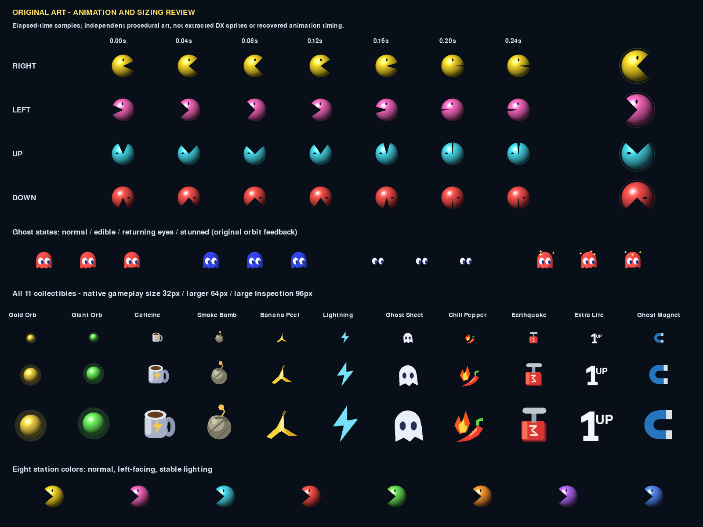
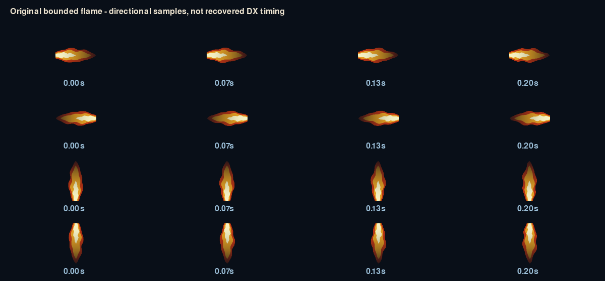

# Revision 11: procedural art, animation and sizing QA

2026-11-08. Original artwork/code retained. This review verifies our own rendered behavior and identifies reference observations separately; no animation timing or pixel identity is certified as commercial DX.

## Concrete defects and corrections

1. **Left-facing eye and rotating illumination:** the old renderer rotated the entire sphere 180 degrees for leftward travel, moving the eye below the mouth and rotating the light source. Facial geometry now changes direction independently of the shaded sphere. Left/right eyes remain above the mouth; up/down faces rotate appropriately. Mouth opening still follows elapsed time, and body size/collision rules are unchanged.
2. **Invisible stun state:** `foe(..., stunned=True)` previously ignored the argument. Added original, supersampled orbiting star feedback. Returning eyes do not show the body/stun ornament. Root passes each ghost's local stun state, including seam copies.
3. **Low-resolution enlarged collectibles:** all 11 icon silhouettes were drawn at 42 pixels before enlargement. They now render their original primitives at 126 pixels, then downsample to the requested size and cache the static result. This improves edge quality at actual 16–96-pixel tested sizes without changing object types or importing assets.
4. **Roaming-item bob jumps:** bob phase previously included screen x, so horizontal movement changed vertical phase. Phase now depends on elapsed time and a deterministic category offset only. Translation by 40 pixels no longer changes y or shape.
5. **Disconnected fire discs:** root requested a new continuous flame after the fresh 2:15 reference showed a broad bright plume. `fire_plume` supplies an original three-layer, supersampled red/orange/pale-core plume with moving asymmetry and fading intensity. It remains within the legal straight run and transverse radius 16. Root splits tunnel-wrap paths into contiguous runs; backwards endpoints are rejected to prevent a cross-board stripe. Shape and timing are adaptations, not traced effects.

## Pass 1: sequences and sizes

Generated `animation_contact_r11.png` (1600×1200): seven mouth-time samples in each cardinal direction, normal/giant sizing, four ghost states at successive times, all 11 collectibles at 32/64/96 pixels, and all eight station colors. Generated `animation_review_r11.gif`, a 72-frame elapsed-time animation plate at 24 fps, approximately three seconds, with actors, ghosts, powers and flames. This is a renderer examination, not a completed gameplay session. Inspected the contact sheet and multiple frames rather than accepting a single still.

Eight `test_animation.py` tests pass. They check left-eye placement, lighting invariance, mouth orientation and changing frames; normal/giant/translucent bounds; distinct stun feedback; 48-frame ghost-foot/star bounds; all 11 icons at six sizes with partial-alpha antialiasing; position-independent bobbing; identical art samples at common elapsed timestamps for 30/60/144 Hz; and flame variation, four-direction bounds and rejection of backwards runs. Tests use Pygame only, not NumPy.

## Pass 2: adversarial corrections and integration

The first supersampled stun implementation clipped stars at the top of its sprite during some phases. A 48-frame bound check reproduced it; orbit placement was corrected with sufficient padding and the regression now passes. All art artifacts were regenerated after that fix and the final flame update. The 29 established smoke checks passed after the main art changes, including gameplay rendering, power/gate/ghost interactions and route-pixel checks. Root performs the final combined/platform suite after App integration.

Static maze drawing is unchanged by this art work: all four map profiles retain the previous broad-wall contour styling and geometry. No speculative topology edit was made. World effects, movement interpolation, stable collectible identities, pause behavior, popups and multi-resolution App rendering are covered separately by the App animation reviewer and root.

## Fresh reference observations, with limits

Reviewed newly captured [1:00](https://www.youtube.com/watch?v=efLgejKG_ls&t=60s), [1:05](https://www.youtube.com/watch?v=efLgejKG_ls&t=65s), [2:04](https://www.youtube.com/watch?v=efLgejKG_ls&t=124s) and [2:15](https://www.youtube.com/watch?v=efLgejKG_ls&t=135s) frames supplied by the research agent. At 2:15 a broad orange flame with a bright core is visible; this supports replacing isolated fire circles qualitatively, not exact plume width/duration. Perspective, glare and motion blur prevent recovering precise actor sizes, eye geometry or frame timing.

The 1:00 and 2:15 views show different nearby wall arrangements while keeping a cyan palette; both show a bottom-facing house doorway in camera orientation. The 1:05/2:04 camera positions differ, so orientation must be established per frame. These observations strengthen the need to separate palette from layout identification; they do not establish that our four authored maps match four commercial mazes.

Remaining differences include exact commercial sprite proportions, frightened expressions, death/growth transitions, power-specific visual feedback and timing, full maze topology, and other reference-undetermined details. This review closes reproduced rendering defects, not overall fidelity.
