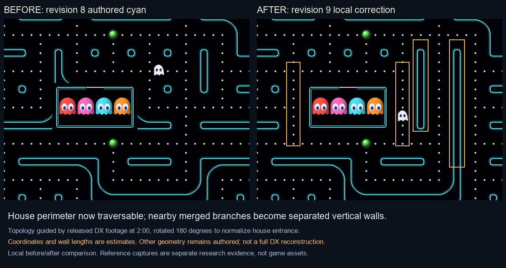

# Revision 9: observed cyan-map correction and two-pass QA

2026-11-08. Scope: `maps.json` and map-specific regression tests. No commercial art or map file imported.

## Evidence and orientation

Inspected actual captured frames from [released DX cabinet footage](https://www.youtube.com/watch?v=efLgejKG_ls&t=120s) at 2:00 (`work/dx-reference-120s.png`) and [1:15](https://www.youtube.com/watch?v=efLgejKG_ls&t=75s) (`work/dx-reference-75s-r9.png`). The house doorway lies at the bottom in the camera images, so the view must rotate 180 degrees to match our top-door simulation orientation. Research reviewer independently confirmed orientation.

At 2:00, two separate vertical capsule walls lie to the raw camera's left of the house; in normalized game orientation they belong to its right. The house is separated from surrounding wall branches by a dotted corridor. At 1:15, the other side confirms a distinct corridor between house and bent wall rather than a merged house/wall mass. Neither image exposes a complete unobstructed maze, and exact lengths or grid coordinates cannot be recovered reliably from perspective alone.

## Change

Cyan Circuit is now map revision 2, catalog version 2. It has 578 lane cells (previously 575): 15 added and 12 removed. Opened the full house perimeter at x21/x33, y13..21 and top/bottom y13/y21; removed two interior cross-corridors at the near right wall and two at the farther right wall; extended the outer-right lane to preserve travel around the longer island. The result is a traversable loop around the house and separated vertical islands instead of branches merging with it. All bays, tunnels, house dimensions, ghost-home coordinates and release route remain unchanged. First three maps remain byte-for-byte unchanged data records.

This is an **OBSERVED DX** qualitative topology correction with estimated lengths/coordinates. It is not a full reconstruction; the remaining branches, outer maze and progression rule remain authored/unknown. Metadata names the source, timestamp, orientation and uncertainty.

## Pass 1: data and focused topology

Catalog validation passed connectedness, paired portals, single center-lines/no 2×2 dot blocks, station/house validity and absence of unintended dead ends. Added a regression requiring the full house loop and uninterrupted two right-side wall footprints with lanes on their sides. Eight `test_maps.py` tests passed, including counts 1–8 on all four maps and sparse first-join station transitions.

## Pass 2: integrated movement and visual review

All 29 existing `test_smoke.py` tests passed against the changed geometry, including every movement edge sampled against rendered wall pixels, all maps/counts, ghost house exit/return, tunnels and power interactions. Visually inspected the actual revised cyan render and annotated before/after crop: the newly available routes are visibly open, and each has one dot line. The house no longer merges with adjacent lower branches. Existing stationary item placement differs because seeded candidate sets change with the graph; that is expected and not evidence of a commercial spawn policy.

No regression reproduced in these targeted passes. Remaining substantial topology differences are retained in issue #1 and the map catalog. Main agent handles full final platform suite, gameplay recordings, replay regeneration and packaging.
